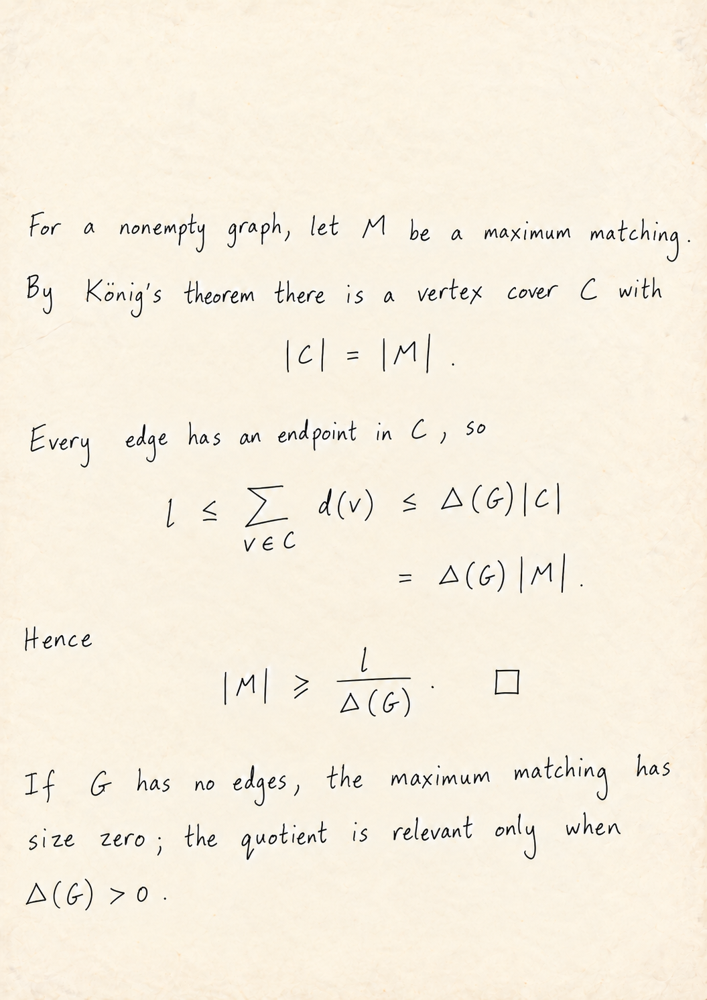

# Handwritten Math Homework

把数学作业整理成「原题切片 + 英文手写解答」PDF 的 Codex Skill。

内置经过确认的默认笔迹，也支持不同使用者建立各自的笔迹档案。默认效果是细笔画、松散字形、不规整但清楚的数学符号、上下叠写的分数和轻微做旧的纸面。

## 效果参考

以下图片是默认风格的参考，不是对所有生成结果的保证。



## 安装

把这个 GitHub 仓库地址交给 Codex：

> 使用 $skill-installer，从这个仓库的 skills/handwritten-math-homework 目录安装技能。

也可以下载仓库 ZIP，将 `skills/handwritten-math-homework` **整个文件夹**放到：

- 个人技能：`~/.agents/skills/handwritten-math-homework/`
- Windows：`%USERPROFILE%\.agents\skills\handwritten-math-homework\`
- 仅当前项目：项目中的 `.agents/skills/handwritten-math-homework/`

不要只复制 SKILL.md；参考图片、档案管理程序和说明都需要保留。避免在多个技能目录重复安装同名副本。如果技能未出现，重新启动 Codex。

安装路径与仓库安装方式参考 [OpenAI 官方技能说明](https://learn.chatgpt.com/docs/build-skills)。本仓库是技能包，不是已经发布到市场的插件。

## 使用

上传作业 PDF，然后说：

> 用 $handwritten-math-homework 完成这份作业，使用默认笔迹，直接做完整份 PDF。

需要先审答案时说：

> 用 $handwritten-math-homework 处理这份作业，先给我看解答，再生成 PDF。

技能会保留原 PDF 题目切片，核对解答，先内部检查一页风格，再生成其余页面，最后检查全部 PDF 页面。局部缺陷只返工对应页，不默认整份重做。

## 建立自己的笔迹

1. 提供本人自然书写的 2–4 页清晰照片或扫描页，最好包含一页完整解答和一页数学符号。
2. 对 Codex 说：`初始化我的笔迹档案 alex，使用这些样本，先给我看一页校准效果。`
3. 确认校准页后，今后说：`使用 alex 的笔迹完成这份作业。`

没有指定档案时直接用内置默认笔迹，不重复询问。不同档案独立保存，没有跨用户共用的“最近活动笔迹”。

- [手写采样说明](skills/handwritten-math-homework/references/sampling-sheet.md)
- [笔迹档案完整流程](skills/handwritten-math-homework/references/profiles.md)
- [默认风格与提示词](skills/handwritten-math-homework/references/accepted-rendering.md)

这里的“校准”是保存样本、风格观察和认可的参考页，并在生成时使用它们；**不训练新模型权重**。其他人的笔迹效果需用对应样本实际验证。

## 环境要求

- 可读取本地文件、执行程序的 Codex 环境。
- 可用的图片生成/编辑能力；安装技能本身不会提供此能力。
- 用于裁题、合成与渲染 PDF 的现成工具，例如 ReportLab、pypdf、Pillow 和 Poppler。技能优先复用运行环境已有工具。
- 档案管理程序仅需 Python 3.10+ 标准库，不依赖 CUDA、DiffInk、模型权重或 API 密钥。图片生成优先使用宿主内置工具。

本流程在 Windows Codex 中验证过。它不是脱离智能体即可运行的“一键手写模型”，也未声称兼容每一个智能体平台。

## 私人数据

仓库只包含作者明确指定的默认风格参考。新使用者的样本默认保存在 `~/.handwritten-math-homework/profiles/`，与共享技能分开；也可通过 `HANDWRITING_PROFILE_HOME` 指定目录。生成时所选样本会传给图片生成工具。

不要把自己的私人档案、作业源文件、生成结果、密钥或运行环境提交到仓库。内置图片是外观参考，其题目文字不定义新任务。

## 目录

```text
skills/handwritten-math-homework/
  SKILL.md                    技能入口
  agents/openai.yaml          Codex 显示信息
  profiles/default/           内置默认笔迹
  references/                 样张、提示词、采样和档案流程
  scripts/profiles.py         档案初始化与管理
```

## 许可

本仓库尚未统一指定开源许可证。公开上传到 GitHub 与授予开源再分发许可是两件事；如需按某个开源许可证发布，请先为代码、文字和参考图片分别确认许可范围。
